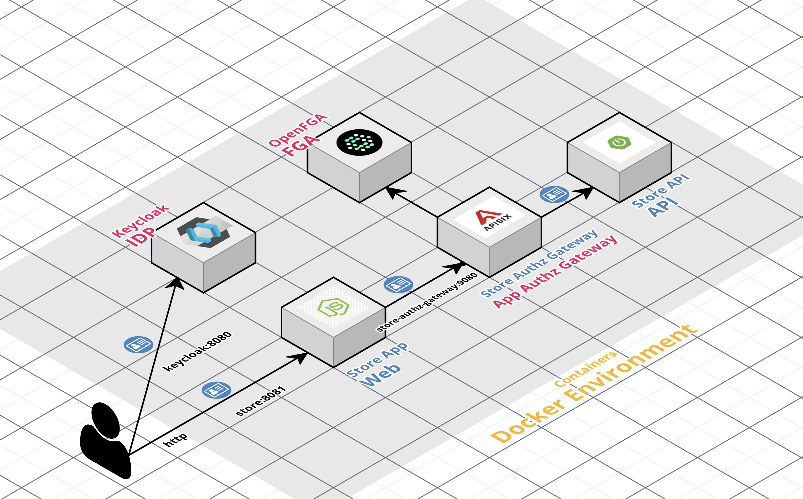
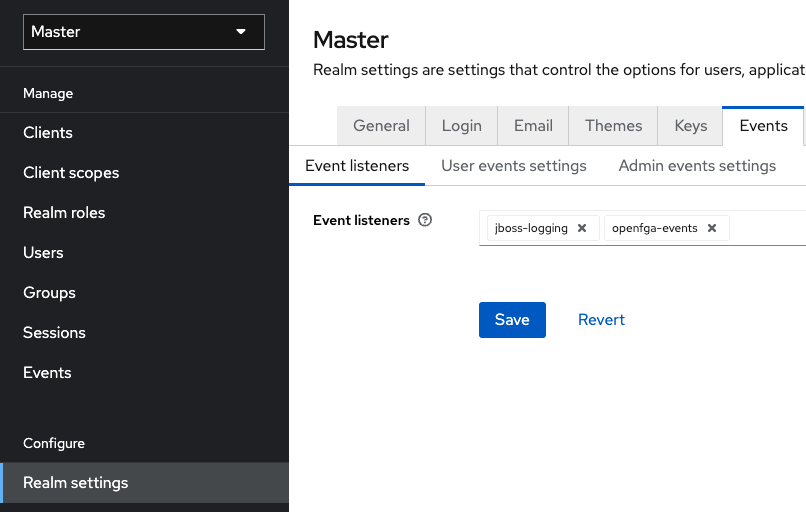
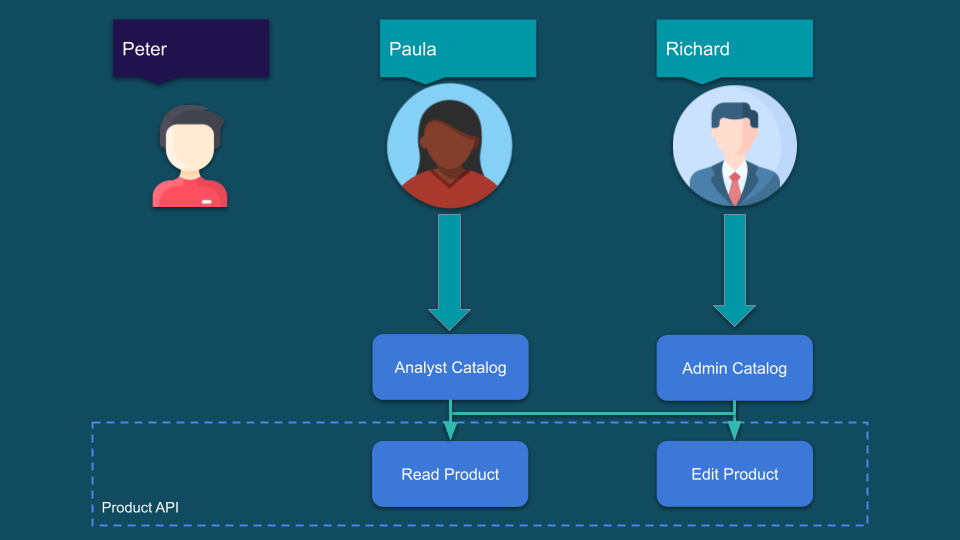
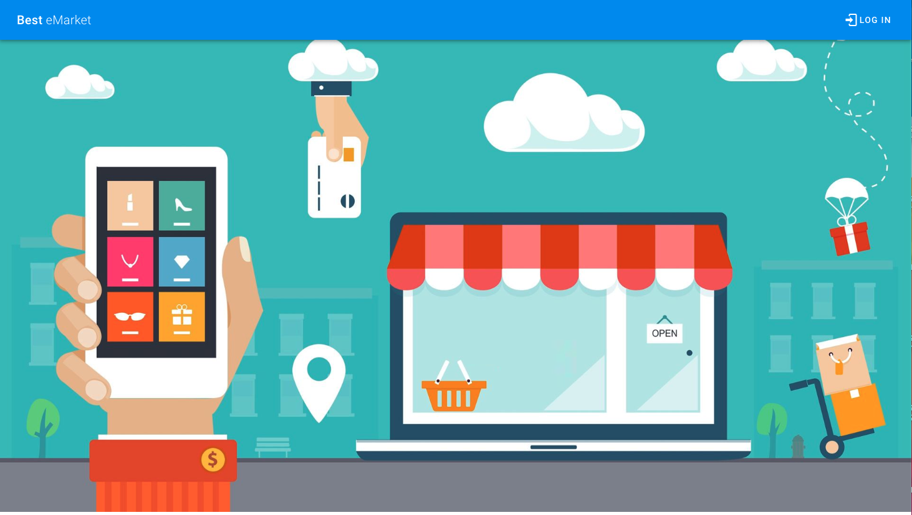
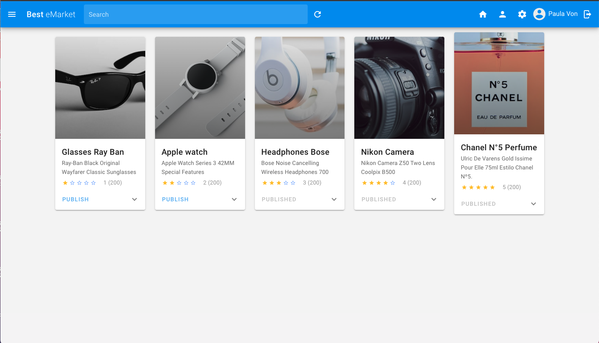
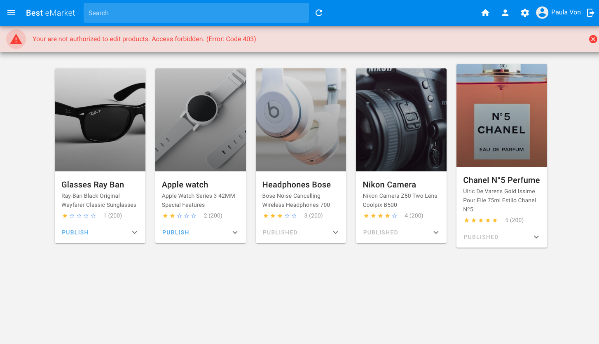
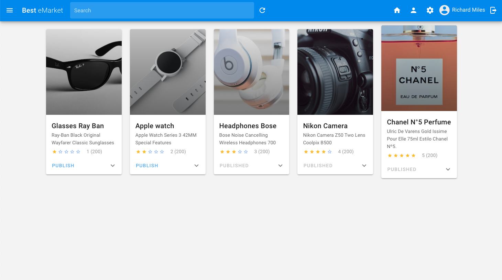
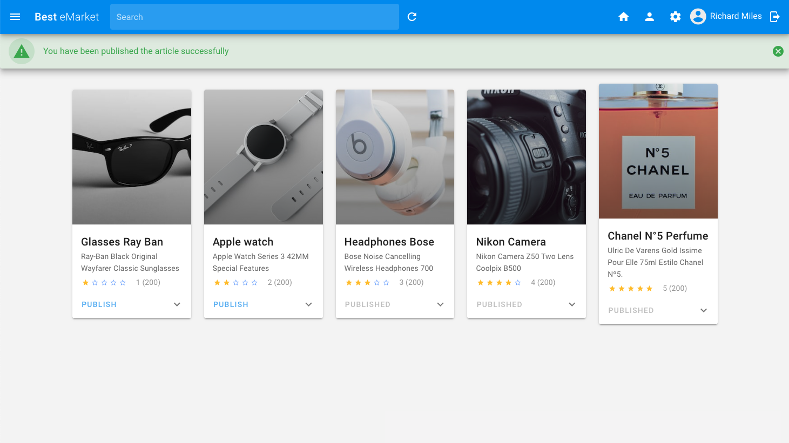
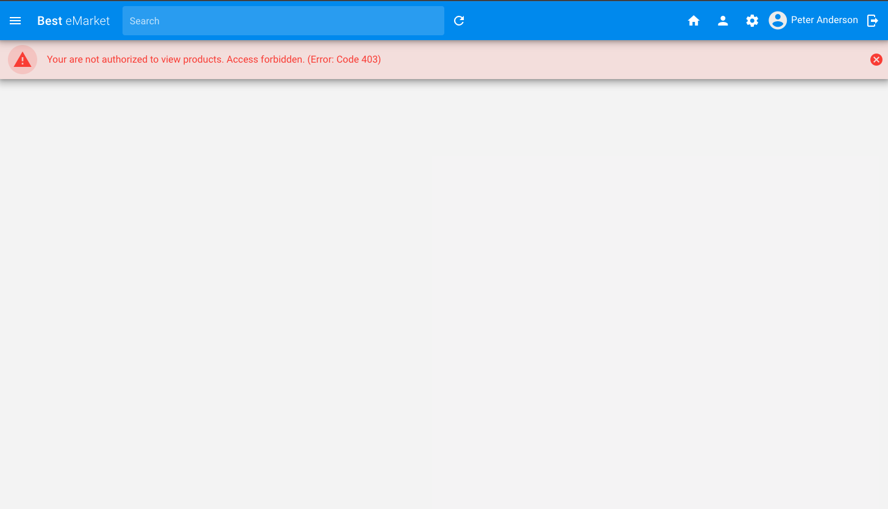

# Keycloak integration with OpenFGA (based on Zanzibar) for Fine-Grained Authorization at Scale (ReBAC)

A hands-on workshop that shows fine-grained authorization with [Keycloak](https://www.keycloak.org/) and [OpenFGA](https://openfga.dev/). Keycloak manages users and roles. The [keycloak-openfga-event-publisher](https://github.com/embesozzi/keycloak-openfga-event-publisher) extension publishes each role change to OpenFGA as a relationship tuple. Apps, APIs and gateways then ask OpenFGA whether a user is allowed.

The workshop is based on these articles, which explain the architecture in detail:

* [Keycloak integration with OpenFGA (based on Zanzibar) for Fine-Grained Authorization at Scale (ReBAC)](https://embesozzi.medium.com/keycloak-integration-with-openfga-based-on-zanzibar-for-fine-grained-authorization-at-scale-d3376de00f9a)
* [Mastering Access Control: Implementing Low-Code Authorization Based on ReBAC and Decoupling Pattern](https://medium.com/@embesozzi/mastering-access-control-implementing-low-code-authorization-based-on-rebac-and-decoupling-pattern-f6f54f70115e)

> [!TIP]
> ### New: extending fine-grained authorization to AI agents
>
> **Fine-grained authorization doesn't stop at users. AI agents need it too.**
>
> When an agent calls MCP tools on behalf of a user, the questions of this workshop come back, with more at stake:
> **who** is calling (the user, the agent, or both), **what** can they do (which tool, on which resource), and **where** is it enforced.
>
> **[Agentic Security Labs](https://github.com/embesozzi/agentic-security-labs)**: hands-on Docker labs that secure MCP tools with open standards, no custom protocols:
>
> - **MCP tool authorization**: [Agent Gateway](https://agentgateway.dev/) is the Policy Enforcement Point (PEP) in front of the MCP server: it asks Keycloak to allow or deny each `tools/call`, per tool and per user.
> - **OpenID AuthZEN**: the standard API between the PEP and the PDP, with Keycloak as the AuthZEN Policy Decision Point. Change the PDP without changing the gateway.
> - **Cedar policies in Keycloak**: the [Keycloak Cedar provider](https://github.com/embesozzi/keycloak-cedar-authorization) brings [Cedar](https://www.cedarpolicy.com/) to Keycloak authorization: readable policy as code, RBAC and ABAC in one language, policies validated against a schema, and a formally verified engine.
>
> **Read more**
>
> - [Implementing OpenID AuthZEN in Agent Gateway: MCP Tool Authorization](https://embesozzi.github.io/posts/martin-besozzi/implementing-openid-authzen-in-agentgateway/)
> - [Cedar Policy Engine in Keycloak: Fine-Grained Authorization for Users and AI Agents via AuthZEN](https://embesozzi.github.io/posts/martin-besozzi/keycloak-cedar-authorization-authzen/)
> - [AI Agents Require Runtime Authorization: Just In Time Passkey Approval for Sensitive Actions](https://embesozzi.github.io/posts/martin-besozzi/ai-agents-runtime-jit-authorization-passkeys-sensitive-actions/)
> - More on the blog: [embesozzi.github.io](https://embesozzi.github.io/) · all links in [More workshops, labs and articles](#more-workshops-labs-and-articles)

## Architecture

<p align="center">
  
</p>

* **Keycloak** authenticates users with OpenID Connect and manages their access with its role model. It runs with the [keycloak-openfga-event-publisher](https://github.com/embesozzi/keycloak-openfga-event-publisher) extension, which:
  * listens to Keycloak admin events (user role assignment, composite roles, group membership, service accounts),
  * maps each event to an OpenFGA tuple of the [authorization model](openfga/model.dsl),
  * publishes it to OpenFGA with the [OpenFGA Java SDK](https://github.com/openfga/java-sdk).
* **OpenFGA** answers authorization checks: does a relationship exist between a user and an object?
* **Store web app**: a Vue app that signs users in with Keycloak (OpenID Connect).
* **Store Authorization Gateway**: Apache APISIX with the [authz-openfga](https://github.com/embesozzi/apisix-authz-openfga) plugin. It protects the Store API with ReBAC policies, so the backend has no authorization code (protection at the API gateway).
* **Store OpenFGA API**: an API protected by OAuth 2.0 that calls OpenFGA with the OpenFGA SDK (protection at the API).

The extension reads the authorization model of the store and handles only the events the model has relations for, so the same extension works with RBAC, group-based access, or both.

<details>
<summary>Authorization model</summary>

```
model
  schema 1.1
type client
type group
  relations
    define assignee: [user, client]
type role
  relations
    define assignee: [user, client] or assignee from parent or assignee from parent_group
    define parent: [role]
    define parent_group: [group]
type user
```

OpenFGA resolves the inheritance: the assignees of a role include the assignees of its parent (composite) roles and the members of the groups that have the role. See [How does it work?](https://github.com/embesozzi/keycloak-openfga-event-publisher#how-does-it-work) for each Keycloak change and the tuple it publishes.

</details>

## Quick start

Requires Git, Docker with Docker Compose, and `make`. The workshop uses the host ports `8080`, `8081`, `9080`, `9090` and `9091`.

| Component | Version |
|-----------|---------|
| Keycloak | 26.8.2 |
| keycloak-openfga-event-publisher | [3.1.0](https://github.com/embesozzi/keycloak-openfga-event-publisher/releases/tag/v3.1.0) |
| OpenFGA | v1.23.0 |

Versions are set in [.env](.env).

**1. Clone the repository**

```shell
git clone https://github.com/embesozzi/keycloak-openfga-workshop
cd keycloak-openfga-workshop
```

**2. Add the workshop hosts to your hosts file** (`/etc/hosts`)

```
127.0.0.1  keycloak openfga store store-openfga-api store-authz-gateway
```

**3. Start the workshop**

```shell
make up      # or: docker compose up -d --build
```

Run `make` to list all targets (`up`, `down`, `restart`, `logs`, `test`, `clean`). This builds Keycloak with the extension ([keycloak/Dockerfile](keycloak/Dockerfile) downloads release 3.1.0 and checks its checksum), creates the `keycloak` store and the model in OpenFGA, and imports the users, roles and clients into Keycloak ([keycloak/import.sh](keycloak/import.sh)). The extension publishes them to OpenFGA.

**4. Open the workshop**

| Component | URL | Credentials |
|-----------|-----|-------------|
| Store web app | http://store:9090 | `paula`, `richard` or `peter` / `demo1234!` |
| Keycloak Admin Console | http://keycloak:8081/admin | `admin` / `password` |
| OpenFGA API | http://localhost:8080 | |
| Store Authorization Gateway | http://store-authz-gateway:9080 | |
| Store OpenFGA API | http://store-openfga-api:9091 | |

The store web app calls the API through the Store Authorization Gateway. To call the Store OpenFGA API instead, set `VUE_APP_API_URL` of the `store` service to `http://store-openfga-api:9091/api/products` in [docker-compose.yml](docker-compose.yml).

**5. Stop the workshop**

```shell
make down    # or: docker compose down -v
```

## What the workshop sets up

### Keycloak

* The `openfga-events-publisher` event listener is enabled in the `master` realm (Realm settings > Events).

  <details>
  <summary>Screenshot</summary>

  

  </details>

* Roles: `admin-catalog` (composite of `view-product` and `edit-product`), `analyst-catalog` (composite of `view-product`).
* Users (password `demo1234!`): `paula` has `analyst-catalog`, `richard` has `admin-catalog`, `peter` has no role.

  <details>
  <summary>Screenshot</summary>

  

  </details>

The extension is configured with environment variables of the `keycloak` service ([configuration reference](https://github.com/embesozzi/keycloak-openfga-event-publisher#configuration)):

| Variable | Value |
|----------|-------|
| `KC_SPI_EVENTS_LISTENER_OPENFGA_EVENTS_PUBLISHER_OPENFGA_API_URL` | `http://openfga:8080` |
| `KC_SPI_EVENTS_LISTENER_OPENFGA_EVENTS_PUBLISHER_OPENFGA_STORE_NAME` | `keycloak` |
| `KC_SPI_EVENTS_LISTENER_OPENFGA_EVENTS_PUBLISHER_OPENFGA_IDENTIFIER` | `name` (roles and groups by name) |
| `KC_SPI_EVENTS_LISTENER_OPENFGA_EVENTS_PUBLISHER_OPENFGA_CREDENTIALS_METHOD` | `none` (also `api_token` or `client_credentials`, see [Authentication](https://github.com/embesozzi/keycloak-openfga-event-publisher#authentication)) |

### OpenFGA

After the import, the `keycloak` store has these tuples:

| User | Relation | Object |
|------|----------|--------|
| `role:admin-catalog` | `parent` | `role:view-product` |
| `role:admin-catalog` | `parent` | `role:edit-product` |
| `role:analyst-catalog` | `parent` | `role:view-product` |
| `user:<paula's id>` | `assignee` | `role:analyst-catalog` |
| `user:<richard's id>` | `assignee` | `role:admin-catalog` |

Users are identified by their Keycloak id, the `sub` claim of their tokens.

<details>
<summary>Read the tuples and run a check</summary>

```shell
STORE_ID=$(curl -s http://localhost:8080/stores | jq -r '.stores[] | select(.name == "keycloak") | .id')

# All tuples
curl -s -X POST http://localhost:8080/stores/$STORE_ID/read -H 'content-type: application/json' -d '{}' \
  | jq -r '.tuples[].key | "\(.user) \(.relation) \(.object)"'

# Can paula view products? (user id from the Admin Console, Users > paula)
PAULA_ID=...
curl -s -X POST http://localhost:8080/stores/$STORE_ID/check -H 'content-type: application/json' \
  -d "{\"tuple_key\": {\"user\": \"user:$PAULA_ID\", \"relation\": \"assignee\", \"object\": \"role:view-product\"}}"
# {"allowed":true, ...}  paula has view-product through analyst-catalog
```

With the [OpenFGA CLI](https://github.com/openfga/cli): `fga tuple read --store-id $STORE_ID`.

</details>

## Use cases

A product catalog with these requirements:

* Only authenticated users can access the application.
* Analysts can view products.
* Admins can view and publish products.

| User | Role | View products | Publish a product |
|------|------|:-------------:|:-----------------:|
| Paula | `analyst-catalog` | ✅ | ❌ |
| Richard | `admin-catalog` | ✅ | ✅ |
| Peter | (none) | ❌ | ❌ |

<details>
<summary><b>Use case 1:</b> Paula (Analyst) can view products but cannot publish them</summary>

1. Open the [store web app](http://store:9090) and sign in with Keycloak as `paula` / `demo1234!`.

    

2. Keycloak returns the ID token and the access token to the app.

3. The app shows the product catalog:

    1. The app calls the products API with the access token in the `Authorization` header.
    2. The API (or the gateway) validates the token and reads the `sub` claim to identify the user.
    3. It asks OpenFGA whether the user is `assignee` of `role:view-product`.
    4. OpenFGA answers `allowed`: Paula has `view-product` through `analyst-catalog`.
    5. The API returns the products and the app shows the catalog.

    

4. Click **Publish** on a product. Paula is not allowed:

    1. The app calls the publish endpoint with the access token.
    2. The API (or the gateway) asks OpenFGA whether the user is `assignee` of `role:edit-product`.
    3. OpenFGA answers `denied`, and the API returns `403`.

    

</details>

<details>
<summary><b>Use case 2:</b> Richard (Admin) can view and publish products</summary>

1. Open the [store web app](http://store:9090) and sign in as `richard` / `demo1234!`.

    

2. The app shows the product catalog: Richard has `view-product` through `admin-catalog`.

    

3. Click **Publish** on a product. Richard is allowed: he has `edit-product` through `admin-catalog`.

    

</details>

<details>
<summary><b>Use case 3:</b> Peter (regular user) cannot view products</summary>

1. Open the [store web app](http://store:9090) and sign in as `peter` / `demo1234!`.

    

2. The app tries to show the products, but Peter has no role, so the API returns `403`.

    

</details>

<details>
<summary><b>Try it:</b> change a role and watch OpenFGA follow</summary>

In the [Admin Console](http://keycloak:8081/admin), assign `analyst-catalog` to `peter` (Users > peter > Role mapping). The extension publishes `user:<peter's id> assignee role:analyst-catalog`, and Peter can now view products: the APIs check OpenFGA on every request, so no new token is needed. Remove the role and the extension deletes the tuple.

</details>

## Automated test

[tests/test_workshop.py](tests/test_workshop.py) (pytest) checks the running workshop end to end: the tuples in OpenFGA, and the three use cases at both enforcement points (the Store OpenFGA API and the Store Authorization Gateway). It runs in a container on the workshop network. CI runs it on every push and pull request.

```shell
make up
make test    # docker run --rm --network keycloak-openfga-workshop_default <tests image>
```

> [!WARNING]
> The import creates a `smoke-test` client with the password grant for the tests. Testing only, not recommended ([RFC 9700](https://www.rfc-editor.org/rfc/rfc9700)).

## Legacy: integration through Kafka

The first version of this workshop published the events through Kafka, before an OpenFGA SDK for Java existed. It is kept in [kafka-integration](kafka-integration/README.md) for reference and is no longer maintained.

## More workshops, labs and articles

**Agentic AI security**

* [Agentic Security Labs](https://github.com/embesozzi/agentic-security-labs): hands-on labs for securing AI agents and the MCP tools they call with open identity and authorization standards (Keycloak, OpenID AuthZEN, Cedar, Agent Gateway).
* [Implementing OpenID AuthZEN in Agent Gateway: MCP Tool Authorization](https://embesozzi.github.io/posts/martin-besozzi/implementing-openid-authzen-in-agentgateway/)
* [Cedar Policy Engine in Keycloak: Fine-Grained Authorization for Users and AI Agents via AuthZEN](https://embesozzi.github.io/posts/martin-besozzi/keycloak-cedar-authorization-authzen/), with the [Keycloak Cedar authorization provider](https://github.com/embesozzi/keycloak-cedar-authorization)
* [Agentic AI Security: Protecting Interactive Keycloak MCP App with OpenID AuthZEN Gateway for FGA](https://embesozzi.github.io/posts/martin-besozzi/agentic-ai-security-protecting-interactive-keycloak-mcp-app-with-openid-authzen-gateway/)
* [AI Agents Require Runtime Authorization: Just In Time Passkey Approval for Sensitive Actions](https://embesozzi.github.io/posts/martin-besozzi/ai-agents-runtime-jit-authorization-passkeys-sensitive-actions/)
* [Mastering Secure APIs and AI Agents with Zero Trust and Fine-Grained Authorization Based on OpenID AuthZEN](https://embesozzi.github.io/posts/martin-besozzi/mastering-secure-apis-and-ai-agents-with-zero-trust-and-fine-grained-authorization-based/)

**Keycloak and OpenFGA**

* [keycloak-openfga-event-publisher](https://github.com/embesozzi/keycloak-openfga-event-publisher): the Keycloak extension used in this workshop
* [apisix-authz-openfga](https://github.com/embesozzi/apisix-authz-openfga): the APISIX plugin used by the Store Authorization Gateway
* [Keycloak integration with OpenFGA (based on Zanzibar) for Fine-Grained Authorization at Scale (ReBAC)](https://embesozzi.medium.com/keycloak-integration-with-openfga-based-on-zanzibar-for-fine-grained-authorization-at-scale-d3376de00f9a)
* [Mastering Access Control: Implementing Low-Code Authorization Based on ReBAC and Decoupling Pattern](https://medium.com/@embesozzi/mastering-access-control-implementing-low-code-authorization-based-on-rebac-and-decoupling-pattern-f6f54f70115e)

**More**

* Blog: [embesozzi.github.io](https://embesozzi.github.io/): posts on IAM, passkeys and AI agent security
* Book: [Keycloak: Identity and Access Management for Modern Applications, 2nd Edition](https://www.amazon.com/Keycloak-Identity-Management-Applications-applications-ebook/dp/B0BPY1RDND)
